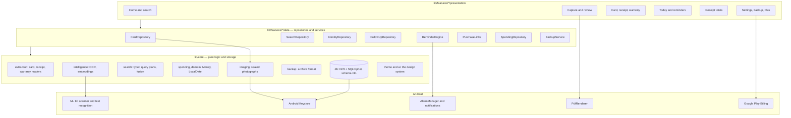
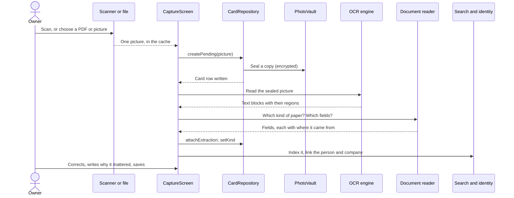
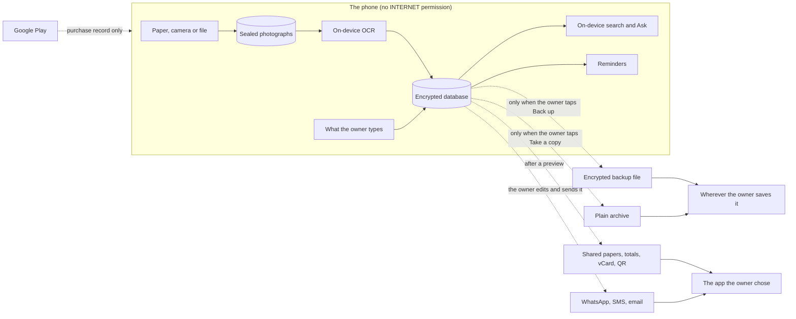
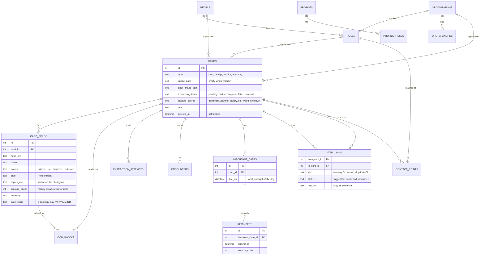
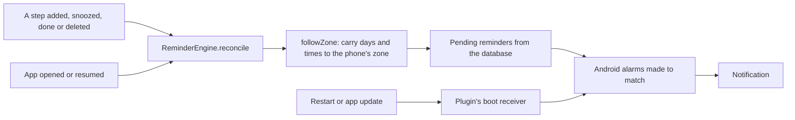

# RecallOS — architecture

How the app is put together, for the report and for whoever maintains it. The
diagrams are Mermaid, so GitHub draws them. Where this file and the code
disagree, the code is right and this file is out of date.

## In one paragraph

RecallOS is a single Android app with no server. Flutter draws it; Riverpod
wires it; Drift over SQLCipher stores it; GoRouter moves between screens. Text
is read on the phone by ML Kit, and search runs on the phone with a bundled
embedding model. The release build has no `INTERNET` permission, so "nothing
leaves the phone" is enforced by the operating system rather than promised.

## Layers

The rule of the layers: `lib/core` knows nothing about screens, and most of it
is pure Dart so it can run in isolates and in tests. Screens read repositories
through Riverpod providers and never touch the database.

## What happens to a scan

Save first: the photograph and the row exist before anything is read, so a
crash leaves a card to recover rather than nothing.

A record that is typed in skips everything down to *attachExtraction*. It has
an empty `image_path` and `extraction_status = manual`.

## Data flow, and where data can leave

Every dotted line starts with the owner doing something. There is no dotted
line the app can draw by itself.

## The database

Schema v11: 27 tables in `lib/core/db/tables.dart`. The ones that carry the
product:

Facts that outlive any one feature:

- **Provenance travels with every value.** A guess must never look printed.
- **Nothing merges people automatically.** Merges are pointers, so they undo.
- **Deleting is soft** until *Delete for good*.
- **The identity graph and the search index are derived.** They can be rebuilt.
- **Money is integer minor units and a currency**, never a floating point.
- **A due day is stored as local midnight**, so `followZone` carries it across
  time zones. A new column that holds a day has to be added there.

## Reminders

The database is the truth and Android's alarms are a copy of it. Each
reminder is scheduled on its own, so one that cannot be set costs nothing but
itself.

## Search and Ask

A question becomes a **typed plan**, never SQL or generated text.

1. `query_plan.dart` works out what kind of question it is.
2. Lookups, totals and "what expires" go to code that reads the database.
3. Open questions run keyword search (FTS) and meaning search (the bundled
   embedding model) together, and the two rankings are merged.
4. An answer cites the papers it came from, or says it cannot answer.

No language model reads anything on a paper, so text on a paper cannot
instruct the app.

## Files

| Where | What |
|---|---|
| `recallos.sqlite` (app documents) | The database, encrypted by SQLCipher |
| `cards/` (app documents) | Sealed photographs |
| App cache | Hand-offs only; `lib/core/storage/hand_offs.dart` says how long each may live |
| Android Keystore | The database key and the photograph key |
| A file the owner chooses | Encrypted backup (Argon2id over the passphrase) |

## Build

Pinned toolchain in `.github/workflows/ci.yml`: analyze, test, release build,
and a check of the merged permissions. `docs/RELEASE.md` has the release steps.
`kEvaluationTools` (`lib/core/build_flags.dart`) is a const, so the development
screens are not in a Play build at all.
