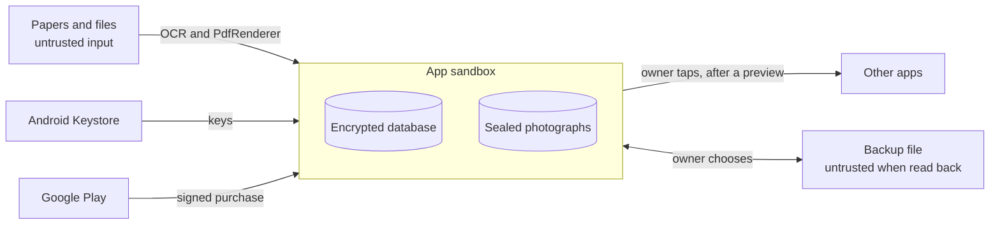

# RecallOS — threat model

What the app protects, from whom, how, and what it does not protect against.
Reports go through `SECURITY.md`. "Evidence" names the test that fails if the
protection goes away.

## What is worth protecting

| Asset | Why it matters |
|---|---|
| The wallet: names, numbers, notes, where people were met | Other people's contact details, and the owner's reasons for keeping them |
| Photographs of cards, receipts, warranties | Addresses, purchases, serial numbers |
| Money figures and warranty dates | Wrong ones cost the owner money |
| The backup passphrase and key material | Open everything |
| The Plus purchase state | The app's only revenue |

## Who, and what they can do

| Actor | Can do |
|---|---|
| Somebody holding the unlocked phone | Open apps |
| Another app on the phone | Use exported components; read shared storage |
| Somebody with a copy of a backup file | Try passphrases offline; edit the file |
| The author of a paper or file | Choose what text is on it; craft a PDF or picture |
| A network attacker | Nothing directly: the release build has no `INTERNET` |
| The person who owns the phone, wanting Plus free | Tamper with their own device |

## Trust boundaries

## Threats and what stands against them

| # | Threat | Protection | Evidence |
|---|---|---|---|
| 1 | Data sent somewhere | No `INTERNET` permission in the release build; no analytics; no logging in `lib/` | `tool/ci/check_permissions.sh` in CI reads the built bundle |
| 2 | Reading the app's files off the phone | SQLCipher (AES-256) on the database; ChaCha20-Poly1305 on each photograph; separate keys in the Keystore | `encrypted_database_test.dart`, `photo_vault_test.dart` |
| 3 | Copy through Android's own backup | `allowBackup="false"` and extraction rules | `release_surface_test.dart`, the manifest |
| 4 | Encryption silently not in effect | The Settings row reports the outcome of the real open, never an intent | `encrypted_database_test.dart` |
| 5 | Plain copies left behind | Every hand-off has a stated lifetime and a launch sweep; a failed write leaves no part-file | `retention_sweep_test.dart`, `photo_vault_test.dart`, `out_of_space_test.dart` |
| 6 | Guessing a backup's passphrase offline | Argon2id, 64 MiB, 2 passes; a random content key wrapped under it | `backup_crypto_test.dart` |
| 7 | A tampered or hostile backup | Authenticated entries bound to the archive and their names; header digest; SHA-256 per photograph; path traversal, size and count limits; a failed restore rolls back | `backup_roundtrip_test.dart` (each a test) |
| 8 | A paper's text treated as an instruction | No language model reads paper text; questions become typed plans, never SQL | `query_plan_test.dart`, `ask_question_set_test.dart` |
| 9 | A paper's text as a spreadsheet formula | Cells starting with `=`, `+`, `-`, `@` are escaped in the export | `spending_export_test.dart` |
| 10 | A file that is not what it says, or is huge | Judged by its first bytes, 25 MB limit, password-protected PDFs refused, one page drawn, size capped | `paper_import_test.dart` |
| 11 | Lock-screen exposure | Notifications are `private`; the content is hidden until unlock | `local_notification_port.dart` |
| 12 | Somebody with the unlocked phone | Optional app lock using the phone's own PIN or biometric, with a lock timeout | `lock_gate_test.dart`, `lock_row_test.dart` |
| 13 | Another app driving RecallOS | Only the launcher activity is exported; every receiver is not | The manifest |
| 14 | Wrong money or dates shown as fact | A total counts only once checked; every value shows where it came from; currencies are never added together | `spending_totals_test.dart`, `field_provenance_test.dart` |
| 15 | Forged Plus purchase | SHA1withRSA check against Play's licence key on every launch; revocation reconciled | `purchase_check_test.dart`, `plus_controller_test.dart` |
| 16 | Losing data to a crash or full phone | Save first; soft delete; migrations tested from every version; a full phone says so | `database_test.dart`, `migration_v11_test.dart`, `out_of_space_test.dart` |

## What it does not protect against

Stated so nobody assumes otherwise.

- **A rooted or compromised phone.** The sandbox and the Keystore are what the
  encryption stands on.
- **Somebody with the phone unlocked and no app lock set.** The lock is the
  owner's choice.
- **Screenshots and screen recording.** `FLAG_SECURE` is not set: people need
  to screenshot a card to send it, and the lock screen shows nothing anyway.
- **A weak backup passphrase.** Argon2id slows guessing; it cannot rescue
  "password".
- **What happens after sharing.** Shared photographs and the *Take a copy*
  archive are not encrypted, and the preview says so.
- **A lost passphrase.** There is no recovery by design.
- **Replaying a genuine purchase receipt.** There is no server to check it
  against (PLAN §5). Accepted: the alternative is an `INTERNET` permission.
- **Parsers below the app.** ML Kit, `PdfRenderer` and the image decoders are
  Android's and Google's. A malicious PDF exploiting one is theirs to patch,
  which is why only one page of one file at a time is ever opened.
